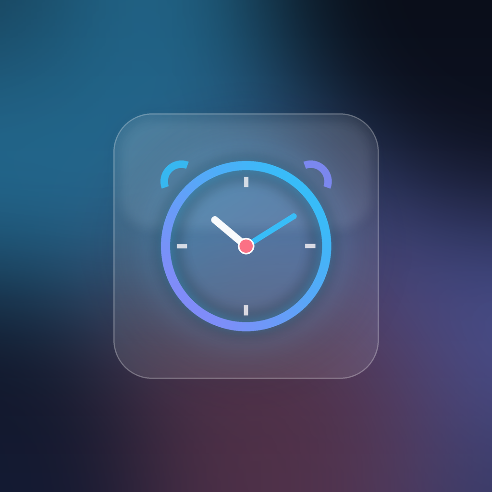

<div align="center">
  

  # ChronoGlass — Ứng dụng Nhắc nhở Thời gian & Báo thức Thông minh

  **Đặt lịch nhắc nhở theo ngày dương lịch chính xác, chọn hàng loạt nhiều ngày cùng lúc, lặp lại linh hoạt & báo thức toàn màn hình trên giao diện Glassmorphism 60FPS.**

  <p>
    
    <!-- VERSION_BADGE_START --><!-- VERSION_BADGE_END -->
    
    
  </p>
</div>

---

## 📥 Tải xuống ứng dụng (Android APK)

Cài đặt trực tiếp bản phát hành chính thức mới nhất của **ChronoGlass** (được biên dịch tự động qua GitHub Actions):

<!-- RELEASE_INFO_START -->
- **Phiên bản mới nhất:** `v1.0.11`
- **Cập nhật lần cuối:** `21/11/2026`
- **Tải trực tiếp file cài đặt:** 👉 **[Tải ChronoGlass-v1.0.11.apk](https://github.com/huyngvan395/Time-reminder/releases/download/v1.0.11/ChronoGlass-v1.0.11.apk)**
- **Trang tổng hợp các bản phát hành:** [GitHub Releases](https://github.com/huyngvan395/Time-reminder/releases)
<!-- RELEASE_INFO_END -->

> **Lưu ý khi cài đặt APK trên Android:** Sau khi tải file `.apk`, mở file và cho phép *"Cài đặt ứng dụng từ nguồn này"*. Lần đầu mở ứng dụng, hãy kiểm tra mục **Trạng thái hệ thống & Quyền báo thức** trong Cài đặt để cấp quyền Báo thức chính xác và Bỏ qua tối ưu hóa pin (đặc biệt trên MIUI, ColorOS, OneUI).

---

## ✨ Tính năng nổi bật

### 🗓️ Đặt lịch chính xác theo ngày (Điểm khác biệt cốt lõi)
- **Chọn ngày chính xác (`DD/MM/YYYY`) & Giờ (`HH:MM`):** Không bị giới hạn theo các thứ cố định trong tuần như ứng dụng đồng hồ mặc định.
- **Chọn nhiều ngày cùng lúc (Multi-Date Batch):** Chạm chọn nhiều ngày bất kỳ trên lịch (VD: `12/10`, `19/10`, `03/11`) để tạo hàng loạt nhắc nhở liên kết trong một lần lưu.
- **Lặp lại linh hoạt:** Một lần (tự động lưu trữ sau khi hoàn thành), theo các thứ trong tuần, hàng tháng theo ngày cố định hoặc **ngày cuối cùng của tháng**, hàng năm / sinh nhật (tự động tính tuổi/năm kỷ niệm), và chu kỳ tùy chỉnh mỗi *N* ngày/giờ.
- **Nhắc trước (Pre-Reminders):** Cấu hình thông báo sớm trước 5 phút, 15 phút, 1 giờ, 1 ngày hoặc tùy chỉnh số phút.

### 🔔 Báo thức mạnh mẽ & Thử thách tắt báo thức
- **Hai chế độ cảnh báo:**
  - *Thông báo chuẩn:* Thông báo nổi kèm nút thao tác nhanh (`Hoàn thành`, `Báo lại`).
  - *Báo thức mạnh mẽ:* Đánh thức màn hình khóa, hiển thị giao diện báo thức Glassmorphism toàn màn hình, đổ chuông lặp với âm lượng tăng dần và rung liên tục.
- **Thử thách tắt báo thức (Dismiss Challenges):** Trượt để tắt (*Slide to Dismiss*), Giữ 3 giây (*Hold 3s*), hoặc Giải phép tính nhanh (*Quick Math*) chống tắt nhầm khi buồn ngủ.
- **Báo lại thông minh (Smart Snooze):** Tùy chỉnh chu kỳ báo lại (5p / 10p / 15p / 30p) và giới hạn số lần báo lại tối đa.

### 🎵 Trình quản lý Nhạc chuông tích hợp & Nhập từ máy
- **6 giai điệu đa âm có sẵn:** *Ban mai Marimba*, *Chuông gió Cực Quang*, *Radar Kinh Điển*, *Bình minh Điện Tử*, *Đàn Hạc Thư Giãn*, và *Báo Thức Khẩn Cấp*.
- **Nhập nhạc chuông từ thiết bị:** Hỗ trợ `.mp3`, `.m4a`, `.wav`, `.ogg`, `.aac`, tự động sao chép vào bộ nhớ riêng của ứng dụng để luôn phát ổn định kể cả sau khi khởi động lại máy.
- **Nghe thử trực tiếp** ngay trong giao diện chọn nhạc chuông ở cả phần Cài đặt chung lẫn từng lịch nhắc riêng biệt.

### 🎨 Giao diện Glassmorphism 60FPS & Tiện ích toàn diện
- **Hai giao diện:** *Frosted Dark Aurora* (mặc định) và *Crystal Light*, tối ưu hiệu năng 60FPS bằng cách chỉ dùng `BackdropFilter` cho thẻ Hero, thanh điều hướng nổi, modal và màn hình báo thức.
- **Hỗ trợ đầy đủ:** Công việc con (Checklist), Danh mục & Thẻ màu tùy chỉnh, Mẫu tạo nhanh, Nhật ký hoạt động (Hoàn thành / Báo lại / Bỏ lỡ), Sao lưu & Khôi phục `.json`, Song ngữ **Tiếng Việt / English**.
- **Độ tin cậy hệ thống:** Tự động đồng bộ lại toàn bộ báo thức sau khi khởi động lại máy (`BootRescheduleReceiver`), kèm thẻ kiểm tra quyền và hướng dẫn tắt giới hạn pin cho các hãng OEM.

---

## 🛠️ Công nghệ & Kiến trúc

| Thành phần | Công nghệ sử dụng |
| :--- | :--- |
| **Framework** | Flutter 3.x (Dart 3+) — Clean Architecture (`domain`, `data`, `services`, `presentation`) |
| **Quản lý trạng thái** | `flutter_bloc` + `equatable` |
| **Lưu trữ Offline-First** | `sqflite` (đánh chỉ mục lịch nhắc & nhật ký) + `hive_flutter` (cài đặt & nhạc chuông) |
| **Động cơ Báo thức** | `flutter_local_notifications` + `android_alarm_manager_plus` + `BootRescheduleReceiver` (Kotlin) |
| **Âm thanh & Rung** | `audioplayers` + `vibration` + `wakelock_plus` |
| **Hệ thống & Sao lưu** | `permission_handler`, `device_info_plus`, `file_picker`, `share_plus` |

---

## 💻 Hướng dẫn build cục bộ (Dành cho lập trình viên)

```bash
# 1. Clone kho mã nguồn
git clone https://github.com/huyngvan395/Time-reminder.git
cd Time-reminder

# 2. Cài đặt thư viện
flutter pub get

# 3. Kiểm tra phân tích mã nguồn & chạy unit tests
flutter analyze
flutter test

# 4. Chạy trên thiết bị / máy ảo Android
flutter run

# 5. Biên dịch bản phát hành APK (Release)
flutter build apk --release
```

File APK sau khi build nằm tại: `build/app/outputs/flutter-apk/app-release.apk`.

---

## 🤖 Tự động hóa CI/CD (GitHub Actions)

Mỗi khi mã nguồn mới được push lên nhánh `main`, workflow [`.github/workflows/android-release.yml`](.github/workflows/android-release.yml) sẽ tự động:
1. Chạy `flutter analyze` và `flutter test`.
2. Biên dịch bản `flutter build apk --release` (R8/ProGuard + tối ưu icon font).
3. Tạo phiên bản GitHub Release mới (`v1.0.<run_number>`) kèm file `ChronoGlass-v1.0.<run_number>.apk`.
4. Tự động cập nhật số phiên bản, ngày phát hành và link tải trực tiếp ngay trong `README.md` này (sử dụng `[skip ci]` để tránh vòng lặp vô hạn).
